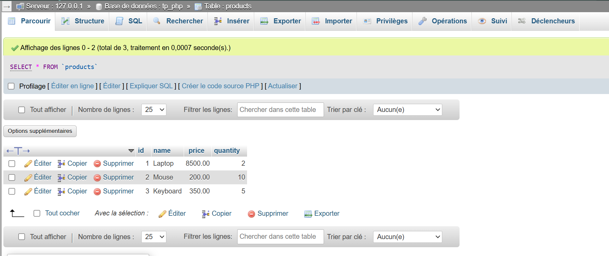

# TP_php

**Nom:** Hiba Lamsselak
**Enseignant:** Aymane Nefdaoui

# Pour Lancer
- Démarrer Apache et MySQL dans XAMPP
- Placer le dossier "TP_php" dans "htdocs"
- Importer database.sql via "http://localhost/phpmyadmin/index.php?route=/import"
- Ouvrir http://localhost/TP_php/

# Travail `réalisé
- Activité 1: message personnaliisés, date et heure
- Activité 2: variable "$ville", nouveau paragraphe et titre 
- Activité 3: http://localhost/TP_php/03-activite3.php?nom=Hiba&ville=Marrakech
- Activité 4: ajoute "ville" au POST, récupéré avec $_POST ["ville"]
- Activité 5: ajouter "categorie" 
- Activité 6: importer base "tp_php"

